# Real-Twin

**(Feel free to revise the document to enhance the accuracy and readability)**

ORNL’s Real-Twin project is a streamlined scenario generation tool that automatically integrates real-world traffic data to create high-fidelity digital twins for simulating the impacts of connected and automated vehicles in microsimulation environments.

## Change Log

### 2026-10-13

#### Refresh the Read the Docs guides and API reference

* State Windows-only support throughout the user guides and align the tutorial prerequisites. Define genetic algorithm (GA), simulated annealing (SA), tabu search (TS), and Bayesian optimization (BO) before their first abbreviated use on each relevant page.
* Update installation, simulator selection, configuration, data/model paths, optional external control and manual re-enabling, native matchup preparation, independent calibration stages, route formats, budgets and result locations. Correct the Aimsun calibration-only example and AV configuration generator description; retain the distinction between simulated tutorial references and field observations.
* Add seven API pages for Vissim, SimAV, AV configuration preparation, SUMO/OpenDRIVE conversion and native Vissim calibration adapters. Preserve maintained API pages during autosummary generation, register the module index, use the package version in Sphinx, exclude support/build files from source discovery, and make badges/static assets compatible with downloadable formats. Retain legacy non-Windows installer pages outside the supported navigation.
* Files: `docs/source/conf.py`, `docs/source/index.rst`, the installation/overview/preparation/generation/simulator/AV/API pages and affected API references, `tutorials/tutorial_realtwin.md`, and this changelog. Generated outputs are under `docs/_build/`; refreshed legacy preview artifacts were backed up there and their tracked copies restored.
* Validation in `rt` with Sphinx 8.2.3: HTML, EPUB and LaTeX source builds passed with warnings treated as errors and empty warning logs. All 11 Python examples passed Python 3.10 syntax checks, all 3 YAML examples parsed, 42 public API signature checks and 68 first-use definition checks passed, and all 2,829 local links/anchors across 86 HTML pages resolved. `git diff --check` passed.
* Limits: PDF compilation, hosted Read the Docs builds/deployment and native simulator tutorials were not run. Existing untracked legacy preview files were preserved.

#### Refresh the Real-Twin tutorial guide

* Update `tutorials/tutorial_realtwin.md` to match the current package, scripts and YAML configuration: distinguish example1 demand/output paths from the supplied example2 network, document optional external control and manual re-enabling across SUMO/Vissim/Aimsun, and explain preserved SUMO identities and explicit OpenDRIVE conversion.
* Add the Vissim workflow, native matchup-table preparation/seeding, demand/signals outputs, 900-second preparation run and calibration requirements. Identify the configured travel-time target as a simulated baseline. Correct the Aimsun executable setting and its current calibration-only script behavior, with preparation steps for new models.
* Document BO installation, independent calibration switches, route formats, stage overrides, calibration time windows, result locations and troubleshooting. Files: `tutorials/tutorial_realtwin.md` and this changelog; no package code or configuration changes.
* Validation in `rt`: all 133 focused configuration, calibration-stage, Vissim workflow and SUMO/Aimsun optional-control tests passed. All 11 Python examples passed Python 3.10 syntax checks and 51 public API signature checks; both YAML examples parsed, all 12 local links/anchors resolved, and documented configuration values matched the checkout. `git diff --check` passed.
* Limits: examples were inspected without running native simulators, installing dependencies or executing full tutorials. No remaining documentation follow-up was identified.

### 2026-10-12

#### Optional Aimsun signal control data

* Add `AIMSUN.is_control_data`, defaulting to true while safely initializing missing/null AIMSUN configuration. Input, abstract and concrete generation set the flag to false when the `Control` folder beside `AIMSUN.model_fname` is missing or has no signal CSV files. An explicit false takes precedence over available CSVs; preparation instructions omit signal requirements when disabled.
* Skip Synchro reads in matchup preparation while retaining existing signal references and deriving traffic data. Continue demand import and skip detector generation, signal import and RealTwin control-plan creation. Pass the flag to scenario generation so a demand-only scenario can be created without requiring or assigning the RealTwin master control plan, including when an older plan exists. Existing control objects remain unchanged and calibration continues using the same `.ang` model. Standalone scenario-script calls without a JSON configuration retain enabled-control behavior.
* Files: `realtwin/rt_aimsun/{rt_aimsun,Step2_MatchupTableDataInput,Step5.1_ScenarioGeneration}.py`, `tests/test_func_sim/test_aimsun_control_data.py`, the Aimsun tutorial, README, generation documentation and this changelog.
* Validation in `rt`: all 72 focused checks passed (40 new Aimsun control cases and 32 existing configuration/shared calibration-workflow cases). Coverage includes missing/empty/non-signal Control contents, CSV directories, model-directory lookup, default/explicit flags, manual re-enabling, conditional script execution, real workbook demand derivation and backup/reference preservation, required demand inputs, calibration handoff, native scenario-object creation with mocked PyANG APIs, optional/stale master plans and legacy script arguments. Python 3.10 syntax and compilation passed for all five changed Python files; `git diff --check` passed.
* Limits: native Aimsun execution and a full tutorial run were not performed. Ruff is unavailable in `rt`. After adding signal CSVs to a disabled workflow, set `twin.input_config["AIMSUN"]["is_control_data"] = True` and regenerate the abstract and concrete scenarios.

#### Optional Vissim signal control data

* Honor `VISSIM.is_control_data=False` during input, abstract and concrete generation. Default the flag to true, initialize missing/null VISSIM configuration, and set it to false when `input_dir/Control` is missing or contains no signal CSV files. Keep demand generation active and omit signal requirements from the preparation instructions when control is disabled.
* Add `--no-control` to the matchup stage and an optional `is_control_data` keyword to its updater. Skip Synchro reads and signal-column derivation while retaining existing workbook references and deriving traffic data. Skip the signal-loading stage and select `<network>_demand.inpx` for simulation and both calibration stages, including behavior preflight, even if a stale `<network>_demand_signals.inpx` exists. Signals already in the source network are retained.
* Files: `realtwin/rt_vissim/{rt_vissim,02_matchup_table,matchup}.py`, `tests/test_rt_vissim/{test_rt_vissim,test_matchup,test_calibration}.py`, README, generation documentation and this changelog.
* Validation in `rt`: all 133 focused Vissim, configuration and shared calibration-workflow tests passed, including 17 additional cases for missing/empty/non-signal Control contents, CSV directories, populated default control, explicit opt-out, null configuration, conditional stages, retained workbook references and stale-network selection. Python 3.10 syntax and compilation passed for all six modified Python files; `git diff --check` passed.
* Limits: native Vissim COM execution and a full tutorial run were not repeated for this change. Existing pandas/Mealpy warnings remain; Ruff is unavailable in `rt`. After adding signal CSVs to a previously disabled workflow, set `twin.input_config["VISSIM"]["is_control_data"] = True` and regenerate the abstract and concrete scenarios.

#### Vissim tutorial behavior calibration configuration and reference route

* Fix the missing native behavior ranges in the tutorial: add explicit Wiedemann 74 `W74ax`/`W74bxAdd` bounds and driving-behavior ID 1 under `Calibration.behavior.vissim`. Resolve this block for the wrapper and standalone stage without changing shared SUMO/Aimsun settings; native ranges replace the entire shared range mapping and per-call overrides retain precedence.
* Validate enabled behavior inputs in `RealTwinVISSIM.calibrate()` before either stage starts, so missing ranges/routes raise a descriptive error in the notebook. Keep route arguments optional for configured routes and demand-only calibration, while retaining positional and keyword route calls. Preserve optional reference provenance in the behavior summary.
* Honor stage-level `calibration_time_step` overrides. Native diagnostics confirmed that this model's controller frequency is 10/s and rejects the shared 1/s simulation resolution; configure the tutorial's Vissim stages at 0.1 seconds while keeping the shared scenario step unchanged.
* Select westbound native links 9 to 15 as requested, with measurement markers at 0.0 and 0.5 metres. A native 08:00-09:00 baseline with seed 42 and resolution 10 measured 39.198670 seconds across 162 completed vehicles. Save the simulated-reference record, source network/signal hashes and Vissim version in `datasets/example1/output/VISSIM/behavior_reference/Shallowford_WB_baseline.json`; use its route/target in the tutorial and label its source explicitly.
* Files: `realtwin/rt_vissim/{rt_vissim,cali_behavior,06_calibrate_turn_inflow}.py`, `tests/test_rt_vissim/test_calibration.py`, `tutorials/{realtwin_config.yaml,tutorial_realtwin_Vissim.py}`, README, generation documentation, the generated reference record and this changelog.
* Validation in `rt`: all 116 focused Vissim, configuration and shared-workflow tests passed. Added regressions cover native/shared range isolation, repeated-call and route-argument precedence, parent-process validation, standalone native settings, stage time-step overrides and reference provenance. Python 3.10 syntax, compilation, YAML parsing and whitespace checks passed. Native Vissim 2026 completed the baseline and a bounded BO behavior run on a model copy, including best-candidate application, saved model/history/route/summary outputs and BO exports under `behavior_reference/bo_validation_b9_5hrk0/VISSIM`. BO stopped after one evaluation at MAE 1.176037 seconds within the configured 3-second tolerance, with 178 completed route measurements and no missing routes; the baseline MAE was zero by construction. The original model hash remained unchanged. Temporary diagnostic directories were removed.
* Limits: the reference is simulated, not observed field data; this validates calibration execution rather than empirical accuracy or improvement over the baseline. Replace the target and provenance with field measurements for real calibration. The baseline still reports lane-change removals and unfinished vehicle input from existing network congestion/geometry. Production-budget searches and a full tutorial run were not performed. Existing pandas/Mealpy warnings remain, and Ruff is unavailable in `rt`.

#### Vissim tutorial demand-stage input repair

* Apply `incl_sumo_net` before importing the network. Pass the configured `input_dir/Traffic` and `input_dir/Control` to matchup, demand and signal stages, and propagate import/table failures instead of continuing with stale exports.
* Reject missing native Vissim link numbers and existing tables whose junction/from/to movement keys differ from the current network. Check before updating workbook cells, with instructions to back up, regenerate and seed observations through the exported junction mapping. Correct tutorial/runtime preparation instructions and initialize the optional behavior-route argument so calibration can use configured routes.
* Repair the existing example1 output workbook: its 104 rows contained no native from/to link IDs, so the demand join was empty. Rebuild 34 movements from `chatt_movements.csv` and copy observations from the existing example1 SUMO table using `chatt_junctions.csv` (SUMO junction 2 maps to native junction 4). Preserve the original workbook byte-for-byte as `datasets/example1/output/VISSIM/MatchupTable_before_vissim_repair_20261012_172512.xlsx`.
* Files: `realtwin/rt_vissim/{rt_vissim,matchup,02_matchup_table}.py`, `tests/test_rt_vissim/{test_rt_vissim,test_matchup}.py`, `tutorials/tutorial_realtwin_Vissim.py`, generation documentation, the repaired example1 Vissim workbook and this changelog.
* Validation in `rt`: all 77 Vissim regression tests passed, including supplied-network ordering, configured data paths, failed-stage propagation, missing/stale link IDs, unchanged rejected workbooks and junction seed translation. Python 3.10 syntax, compilation and whitespace checks passed. Native Vissim 2026 completed `generate_abstract_scenario()` (zero validation findings) and `generate_concrete_scenario()` for 08:00-09:00, creating four inputs, ten routing decisions, 34 routes, one controller, eight heads, eight detectors, 53 conflict-area decisions and four right-turn-on-red stop signs. Both concrete networks are now generated in example1's VISSIM output folder; source networks, export CSVs and the source SUMO workbook retained their hashes.
* Limits: unsurveyed entry links 10 and 11 retain zero demand for calibration, and unobserved turn splits retain existing equal-share defaults. A full simulation and calibration were not rerun for this repair. Existing pandas forward-fill deprecation and tiny-population Mealpy warnings remain. Ruff is unavailable in `rt`.

#### Vissim calibration stages and shared optimizers

* Run turn/inflow and driving-behavior calibration independently, or run behavior against the demand stage's saved network. Apply per-call overrides before selecting enabled stages, pass effective settings and user paths to the package stage, and preserve the shared Calibration mapping and input networks. An explicit stage-result manifest prevents reuse of an older demand output when there are no calibration variables.
* Replace copied Aimsun simulator calls with native Vissim adapters in `cali_turn_inflow.py` and `cali_behavior.py`. Dispatch their GA (default), SA, TS and BO methods through the existing `run_calibration_algorithm`; reuse the package's BayesianOptimization with Vissim result names. Honor algorithm settings, stage stop limits, independent simulator/optimizer seeds, simulation times/resolution and configured GEH targets.
* Correct COM simulation/evaluation ownership, reset before each candidate and apply the optimizer's best candidate before saving. Discover demand variables and exclusive movement counters from native network topology, retain parallel lane paths and actual routing intervals, and reject missing observations/counters or incomplete count-window coverage before opening Vissim. Behavior minimizes route travel-time MAE in seconds with explicit continuous native parameter ranges and driving-behavior IDs. Validate the Wiedemann model and measurement markers; penalize missing completed vehicles and reject a best candidate with missing routes before saving. Optional route_positions specify field measurement markers in metres and are recorded in the summary.
* Files: `realtwin/rt_vissim/{rt_vissim,calibrate,calibrate_vissim,cali_turn_inflow,cali_behavior,06_calibrate_turn_inflow}.py`, `realtwin/func_lib/_f_calibration/algo_sumo/_bayesian_opt.py`, `tests/test_rt_vissim/test_calibration.py`, README, generation documentation and this changelog. The actual stage filename is `06_calibrate_turn_inflow.py`.
* Validation in `rt`: all 167 focused Vissim, shared optimizer and configuration checks passed, including real GA/SA/TS/BO searches against simulated COM objects, independent stages/overrides, explicit measurement markers, source preservation and invalid/missing input handling. Two warnings came from mealpy TS diversity plotting with tiny test populations. Python 3.10 syntax, compilation and whitespace checks passed for all eight changed Python files. Native Vissim 2026 completed sequential SA demand and behavior calibration and a BO demand run on a temporary Chattanooga fixture, including saved-model handoff, configured seeds, 900-second candidate simulations and result exports; the behavior route measured five completed vehicles without missing data. Original dataset hashes remained unchanged, and the disposable validation script was removed.
* Limits: these small native runs validate execution and exports, not convergence or production calibration accuracy. Native GA/TS and behavior BO were not run; their adapters use real optimizers in the focused regressions. A broader check earlier in this work had 312 passes and one existing SUMO conversion failure (`test_generate_inputs_exports_without_rewriting_source[True]`); its SUMO files are unchanged by this calibration work. Ruff is unavailable in `rt`.

#### Preserve SUMO identities through OpenDrive export

* Keep the source SUMO network as the authoritative simulation input. Export a separate OpenDrive file for both supplied and generated networks, populate the abstract/concrete supply with the actual `.xodr` path, and remove the forced OpenDrive-to-SUMO overwrite and negative-ID renaming.
* Restore OpenDrive road and junction IDs from native source metadata rather than XML order. Save SUMO lane identities, endpoint junctions, signal programs and controlled-connection indices in `userData`. Explicit reverse conversion uses temporary numeric road IDs for netconvert, restores source IDs and references into a separate output, and reports changed signal topology instead of applying invalid saved programs. Split roads retain distinct native segment IDs.
* Keep exact road IDs in new matchup tables and in demand, signal and calibration lookups, including negative IDs and underscores. Support legacy tables that omitted a leading `-` only when the exact ID is absent. Preserve existing controller IDs when adding external control, and use the prepared network path for demand generation with custom output directories.
* Files: `realtwin/rt_sumo/{rt_sumo,xodr_sumo}.py`, `realtwin/func_lib/_c_abstract_scenario/{_abstractScenario,_network,rt_matchup_table_generation}.py`, `realtwin/func_lib/_e_simulation/_sumo.py`, `realtwin/func_lib/_f_calibration/{calibration_sumo,algo_sumo/util_cali_turn_inflow}.py`, `realtwin/util_lib/mapping_SUMO_OpenDrive_ID.py`, the SUMO control/conversion/signal regression files, README, generation documentation, and this changelog.
* Validation in `rt`: 291 simulation, calibration and configuration tests passed before the final conversion edge cases were added; all 48 focused conversion/control tests and all 12 signal-import tests passed after the final changes. The regressions include 25 new conversion cases and a new real Synchro import check that preserves a custom controller ID with exact source road IDs. Native netconvert and jtrrouter checks cover separate supplied/generated exports, reordered roads, mixed positive/negative/string IDs, multiple lanes, controller IDs, phase programs, controlled lane indices, intact XML references, unchanged sources and original-ID routing. Python 3.10 syntax checks passed for all 12 modified Python modules, and `git diff --check` passed. Fifteen Gaussian-process convergence warnings came from existing calibration tests.
* Limits: geometry and internal topology may change during explicit native conversion; arbitrary OpenDrive files without the saved metadata retain native generated SUMO IDs with origin parameters. Native Aimsun/Vissim imports and production-dataset simulations were not run. Ruff is unavailable in `rt`.

### 2026-10-11

#### Optional SUMO signal control data

* Honor `SUMO.is_control_data=False` throughout abstract-scenario generation and SUMO preparation. Skip control-folder validation, Synchro reads, signal ID reassignment, and external signal import; clear abstract signal data while continuing traffic processing. `ConcreteScenario` already carries the same configuration into simulation preparation, so its implementation remains unchanged.
* Keep existing source-network signal logic and enabled/default loading behavior. Guard direct `SUMOPrep.importSignal()` calls, and safely initialize the SUMO configuration when input generation disables missing or empty control data.
* Files: `realtwin/rt_sumo/rt_sumo.py`, `realtwin/func_lib/_c_abstract_scenario/{_abstractScenario,rt_demand_generation}.py`, `realtwin/func_lib/_e_simulation/{_generate_simulation,_sumo}.py`, `realtwin/util_lib/check_abstract_scenario_inputs.py`, `tests/test_func_sim/test_sumo_control_data.py`, README, generation documentation, and this changelog.
* Validation in `rt`: all 270 simulation, SUMO workflow, and configuration tests passed, including 23 new regressions for disabled/enabled/default control handling, missing demand inputs, scenario handoff, and network/config output with missing, empty, or populated Control folders. `git diff --check` passed. Fifteen Gaussian-process convergence warnings came from the calibration tests.
* Limits: native SUMO execution and routing were not rerun; the scenario-handoff tests mock demand generation/import while exercising the real scenario, network, and configuration writers. Ruff is unavailable in `rt`.

### 2026-09-22

#### Vissim prepared-simulation handoff

* Apply signal control to the demand network and run the resulting `<network>_demand_signals.inpx`, so the prepared simulation contains both concrete-scenario stages.
* Pass the simulation duration as a valid subprocess string, use the package-qualified Vissim COM import in stage 5, and make the completion status independent of the environment-selection list.
* Files: `realtwin/rt_vissim/{rt_vissim,05_check_run}.py`, `tests/test_rt_vissim/test_rt_vissim.py`, and this changelog.
* Validation in `rt`: all six focused Vissim tests passed. A live integrated rebuild followed by a 900-second Vissim 2026 run exited successfully; moving the short-link decision downstream removed the prior link-4 routing errors and reduced removed vehicles from 17 to 7. The remaining seven were reported as route 8-to-4 lane-change congestion/geometry, not missing routing information.

#### Vissim short-link routing decisions

* Keep static-route endpoints inside short links produced by OpenDRIVE import and move the following routing decision to the next valid downstream link when the short link cannot provide normal spacing. Existing marker positions remain unchanged on normal-length links.
* Stream the demand and signal stage output to the console so Vissim COM failures retain their actionable diagnostic text, and correct the signal-stage label from Aimsun to Vissim.
* Files: `realtwin/rt_vissim/{routes,writer,rt_vissim}.py`, `tests/test_rt_vissim/test_rt_vissim.py`, and this changelog.
* Validation in `rt`: focused short-link and concrete-scenario regressions passed, and a live `generate_concrete_scenario()` run against Vissim 2026 created 4 vehicle inputs, 10 routing decisions, 34 routes, 1 signal controller, 8 signal heads, 8 detectors, 53 conflict-area decisions, and 4 right-turn-on-red stop signs before writing both concrete-scenario networks and exiting successfully.

#### Vissim tutorial stage imports

* Run Vissim stage scripts as package modules so their directory does not shadow Python's standard-library `signal` module during subprocess startup.
* Add a regression test that verifies the input-generation stages use `python -m realtwin.rt_vissim.<stage>`.
* Files: `realtwin/rt_vissim/rt_vissim.py`, `tests/test_rt_vissim/test_rt_vissim.py`, and this changelog.
* Validation in `rt`: the focused regression test passed, compilation passed, and the live tutorial imported the Vissim network, generated `MatchupTable.xlsx`, accepted the documented confirmation, and exited successfully. Ruff was unavailable in the environment.

### 2026-09-10

#### Inline adapter GA setup

* Remove `create_ga_model` and delete `realtwin/func_lib/_f_calibration/_optimizer_support.py` as requested. Keep GA construction directly in each SUMO/Aimsun adapter's `run_GA` method and inline result exporting in the three adapters that used the deleted module.
* Preserve optimizer defaults, keyword validation, stage initialization, termination, best-solution application, BO exports, and independent calibration controls. Update real GA tests to exercise the public adapter and revise README code-organization guidance.
* Files: both `algo_sumo/{cali_turn_inflow,cali_behavior}.py` adapters, `rt_aimsun/{cali_turn_inflow,cali_behavior}.py`, the deleted helper module, `tests/test_func_sim/test_calibration_optimizers.py`, README, and this changelog.
* Validation in `rt`: 92 optimizer/export checks and all 370 local tests passed; web-download tests were excluded. No helper definitions/imports/calls remain in production code or tests. Ruff checks report no new adapter findings; signatures, Python 3.10 syntax, compilation, and whitespace checks passed. A fresh wheel excludes the deleted module and contains the current adapters. Native simulations were not rerun.

#### Optimizer and API cleanup (second pass)

* Use Python AST inspection to identify duplicated adapter logic, then replace four GA construction blocks with one `create_ga_model` function. Each adapter retains its configuration errors, initialization, termination settings, objective arguments, and final best-solution application. Its GA method now has 7-8 executable statements instead of 32.
* Share the three identical result-export implementations through `save_calibration_results`, preserving BO error propagation and nonfatal Mealpy plotting errors. Add only these two shared functions; retain public adapter methods and remove obsolete commented examples and cleanup code.
* Complete the existing legacy `RealTwin` removal in package exports, tests, examples, and API documentation. Migrate executable-discovery tests to `find_executable_on_win`, isolate test configuration between cases, and retain old documentation URLs as pointers to current APIs. This resolves both collection errors reported in the first pass.
* Files: `realtwin/func_lib/_f_calibration/_optimizer_support.py`; both SUMO and both Aimsun calibration adapters; `realtwin/__init__.py`; SUMO/Aimsun API docstrings; `tests/test_realtwin.py`, `tests/test_func_utils/test_util_find_exectuable.py`, and `tests/test_func_sim/test_calibration_optimizers.py`; README, simulator tutorials, `docs/source/pages/{api.rst,create_api.py,realtwin_generation.rst}`, current/legacy API pages, and this changelog.
* Validation in `rt`: all 370 local tests passed, including 92 optimizer checks covering GA variants, constructor keywords, stage side effects, export failures, and real Mealpy runs for all five GA variants. Web-download tests were excluded. Existing BO and independent-stage regressions continue to pass.
* Ruff lint/format checks passed for new code and migrated tests; modified adapters introduce no new lint findings. Adapter signatures remain unchanged. Compilation, Python 3.10 syntax parsing, whitespace checks, and a fresh-directory wheel build passed; all 12 changed/new production modules in the wheel match current sources.
* Sphinx validation completed with source generation disabled. Three unrelated warnings remain in `s5defs.txt` and `requirements_dev.txt` (markup/toctree entries). Native Aimsun/SUMO simulations and a separate Python 3.10 runtime were not rerun. No dependencies, BO equations, or calibration parameter units changed.

#### Calibration readability refactor

* Consolidate stage selection, per-stage overrides, and GA/SA/TS/BO dispatch into three shared functions. Keep preparation, route precedence, output paths, and cleanup visible in the SUMO and Aimsun workflows; retain independent enable flags and existing best-candidate application.
* Share Aimsun console execution through one UTF-8, unbuffered runner, retaining imports from both calibration modules. Remove an empty visualization exception block and simplify public calibration methods and docstrings.
* Preserve the workspace's existing legacy `RealTwin` removal and autonomous-vehicle tutorial edit. Update focused calibration tests to use the active `RealTwinSUMO` and `RealTwinAimsun` APIs.
* Files: `realtwin/func_lib/_f_calibration/{_calibration_workflow,calibration_sumo}.py`; `realtwin/rt_sumo/rt_sumo.py`; `realtwin/rt_aimsun/{rt_aimsun,calibrate_aimsun,_console,cali_behavior,cali_turn_inflow}.py`; `tests/test_func_sim/{test_bayesian_optimization,test_calibration_stages,test_calibration_workflow}.py`; README and this changelog.
* Validation in `rt`: 106 focused tests passed, including 27 new characterization cases covering dispatch order, failures, overrides, route precedence, and subprocess output. Broader local testing reported 251 passed and two existing collection errors: the legacy `tests/test_realtwin.py` import after the workspace's class removal, and a missing executable-discovery module. Web-download tests were excluded.
* Ruff lint and format checks passed for new modules and focused tests; modified legacy modules have no new lint findings versus the pre-refactor snapshot. Edited production modules parse with Python 3.10 syntax; public calibration signatures are unchanged. Compilation, whitespace checks, and a wheel build from a fresh directory passed; its packaged modules match current sources. No dependencies or optimizer equations changed.
* Limits: native Aimsun/SUMO simulations and a separate Python 3.10 runtime were not rerun for this structural refactor. The remaining legacy test imports require their own migration.

#### Aimsun BO and independent calibration stages

* Reuse the shared BO optimizer for Aimsun turn/inflow and behavior calibration, with `input_config` callbacks, normalized parameter bounds, best-candidate application, and `aimsun_bayesopt_*` CSV/plot exports beside the model.
* Make `Calibration.turn_inflow.is_calibration` and `Calibration.behavior.is_calibration` independent across `RealTwin`, `RealTwinSUMO`, and `RealTwinAimsun`. Disabled algorithms can be omitted or ignored; both stages disabled returns False without running calibration. Propagate calibration failures and merge per-stage BO overrides with shared settings.
* Allow SUMO behavior-only calibration directly from prepared network/demand files when no turn/inflow output exists. Prior EdgeData is optional; incomplete required inputs now identify the missing files and preparation step.
* Require routes only for enabled Aimsun behavior calibration, accepting argument or configuration routes. Missing routes no longer silently change the enable flag. Preserve canonical Aimsun behavior bounds and write the assignment CSV in the order expected by Step7.2, correcting swapped sensitivity and maximum-deceleration values.
* Keep Aimsun Python subprocess output unbuffered so required subpath IDs survive its observed native shutdown crash.
* Files: `realtwin/rt_aimsun/{rt_aimsun,calibrate_aimsun,cali_turn_inflow,cali_behavior}.py`, `realtwin/func_lib/_f_calibration/algo_sumo/_bayesian_opt.py`, `realtwin/func_lib/_f_calibration/calibration_sumo.py`, `realtwin/{_realtwin.py,rt_sumo/rt_sumo.py}`, packaged/tutorial configurations, both simulator tutorials, README, generation documentation, `tests/test_func_sim/{test_calibration_stages,test_bayesian_optimization}.py`, and this changelog.
* Validation in `rt`: all 94 BO/stage regression cases passed, including 47 added in this follow-up. The broader suite reported 257 passed, the same two existing calibration tests lacking a Calibration fixture, and the existing executable-discovery collection error. Web-download tests were excluded. Shared BO/tests pass Ruff lint/format checks; changed existing modules add no lint findings relative to the pre-task snapshot. Compilation, YAML checks, whitespace checks, and a local wheel build passed.
* Live Aimsun turn/inflow-only and behavior-only checks each completed two evaluations plus best-candidate application on independent model copies. Applied turn/inflow and behavior CSVs matched the exported best candidates; original model/input hashes stayed unchanged. A live SUMO behavior-only run completed from prepared files without a turn/inflow directory.
* Limits: the bounded live runs validate integration rather than optimization quality. Aimsun Console still exits with native code `0xC0000374` after some completed operations; its existing fresh-output checks and retained script output allow these successful runs to be verified. VISSIM and Python 3.10 were not exercised.

#### Initial SUMO BO integration

* Add Bayesian optimization (BO) for SUMO turn/inflow and driving-behavior calibration through both `RealTwin.calibrate()` and `RealTwinSUMO.calibrate()`, adapting the GitLab Real-Twin workflow. GA remains the default.
* Add optional `realtwin[bo]` dependencies, shared `Calibration.bo_config` settings, five kernel choices, reproducible independent runs, and CSV/convergence-plot exports. Apply per-stage algorithm overrides without modifying the shared settings; honor nested inflow limits and behavior parameter ranges.
* Correct source BO issues involving repeated seeds, scalar/list fitness values, constant fitness, fixed parameters, evaluation-budget overruns, and quadratic candidate-distance storage. Use a multidimensional periodic covariance with a fixed period equal to each parameter's bound span. Reapply the best candidate once per stage so generated simulation files match the selected input; this application is outside the search budget.
* Support behavior-only calibration using existing turn/inflow files by initializing its configuration independently and setting the network/simulation names.
* Files: `realtwin/_realtwin.py`, `realtwin/rt_sumo/rt_sumo.py`, `realtwin/func_lib/_f_calibration/calibration_sumo.py`; `algo_sumo/_bayesian_opt.py`, `_bayesian_opt_util.py`, `cali_turn_inflow.py`, and `cali_behavior.py`; `pyproject.toml`, packaged/tutorial YAML configurations, the SUMO tutorial, `README.md`, `docs/source/pages/realtwin_generation.rst`, `tests/test_func_sim/test_bayesian_optimization.py`, and this changelog.
* Validation in the `rt` conda environment: all 47 new BO regression cases passed. The broader local suite reported 210 passed, two existing failures from test configurations without `Calibration`, and one existing collection error for the missing `find_executable_from_PATH_on_win` module. The two failing tests also fail against unchanged HEAD; web-download tests were excluded.
* New BO modules/tests pass Ruff lint and formatting checks; modified existing modules introduce no new Ruff findings relative to HEAD. Compile checks, whitespace checks, YAML parsing, and a local wheel build with BO module/dependency-metadata inspection passed.
* Real SUMO validation on isolated example2 copies passed: both stages completed two evaluations plus best-candidate application. A separate behavior-only periodic-kernel run completed ten initial and two surrogate-selected evaluations plus best-candidate application. Generated XML parsed, final candidates matched the exported best rows, and source inputs/existing turn files retained their hashes.
* Limitations: these bounded runs verify integration, not calibration quality or comparative optimization performance. Existing simulator randomness and behavior-parameter repairs can affect repeatability; GP fitting can emit convergence warnings. Aimsun/VISSIM and a Python 3.10 runtime were not exercised.

### 2026-09-08

* Document editable installation in the debugger's Python environment to resolve `ModuleNotFoundError: No module named 'realtwin'` when launching tutorials from a cloned checkout. Explain why the tutorial's `os.chdir(...)` does not update the import search path. Files: `README.md`, `CHANGELOG.md`.
* Support pandas 3 in SUMO signal preparation by retaining mixed lane values and updating phase DataFrames directly under Copy-on-Write. Normalize shared-lane comparisons so protected turns and right-turn-on-red states are updated consistently.
* Preserve fractional calibration ratios and inflows with explicit floating-point columns. Convert traffic counts before filling missing values and replace the removed fillna(method=...) API.
* Align runtime and documentation dependencies for pandas 3 on Python 3.11+, retaining pandas 2 support on Python 3.10.
* Files: SUMO signal preparation, abstract-scenario traffic loading, both SUMO calibration utilities, runtime/documentation requirements, README, and two new regression-test modules.
* Validation on Python 3.12.9 / pandas 3.0.3: 17 new regression cases passed; the broader local suite completed 165 tests successfully with one existing collection error for the missing executable-discovery module. Web-download tests were excluded. New tests pass Ruff formatting and lint checks; modified production modules introduce no new Ruff findings relative to HEAD, and focused whitespace checks pass.
* Integration: prepare_simulation() generated valid network, flow, turn, route, and configuration XML using a temporary copy of example2; a one-second SUMO smoke test exited successfully. Original input and network hashes were unchanged. Full calibration runs, Aimsun/VISSIM execution, and a Python 3.10 runtime were not exercised.

### 2026-08-25

* Stream the Aimsun version-check command output to the terminal while retaining version detection.

### 2026-08-17

* Find Windows executables outside `PATH` by searching the system drive, prioritizing standard installation directories such as `Program Files`.
* Preserve the original executable-discovery module import while using the clearer module name internally.

### 2026-02-19

TODO:

* [ ] Add citation to realthedocs - Contact page
* [ ] Add Autonomous Vehicle simulation to -> readthedocs - Scenario Generation

### 2025-10-01

* Add testing functions for the realtwion with coverage from 22% to 38%.  Will implement core-functionalities only in the future update.

  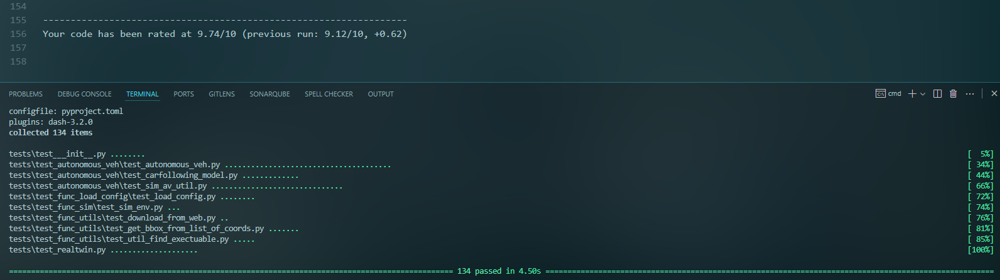

### 2025-09-30

* refactor code with pylint score of 9.74/10
* include coveage.py for test of robustness of developed code: coverage run -m pytest

TODO:

    improve the code coverage from 22% coverage to 90% plus

### 2025-08-07

* mapping SUMO and OpenDrive IDs

### 2025-08-05

* update tutorial documents
* update autonomous vehicle configuration

TODO:

* SUMO & OpenDrive ID mapping Integration
* Update readthedocs

### 2025-08-04

* add Autonomous Vehicle Simulation
* update copyright info

### 2025-06-04

* Add security.md
* Add code of conduct
* Make consistancy between readthedocs and GitHub repository

### 2025-05-29

* Not create OpenDrive file if inc_sumo_net assigned in generate_inputs()
* Not create SUMO network from vertices if it exists (might take long time generating sumo network)

TODO

* Could not load / create flow data as junction attributes might changed from user and this will cause error in creating inflow data.

### 2025-05-28

* Auto selection calibration variables for turn and inflow
* Clean up input configuration file to minimize user inputs
* Format print out message for better message noticing
* Force to terminate the program after the generation of Matchup Table.
* 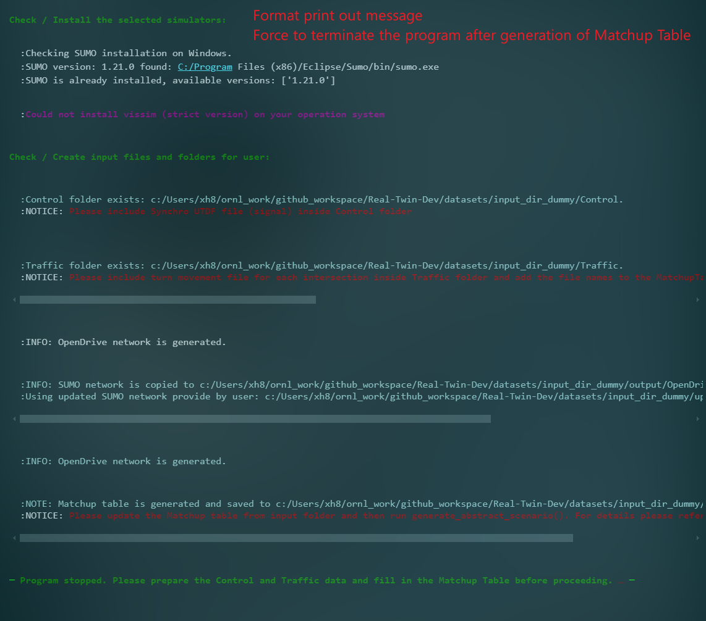

### 2025-05-26

* Add Python 3.10 as minimum Python version.
* Generate Matchup Table on each time of running generate_inputs(), will re-write existing Matchup Table.
* Update logic for user updated SUMO network

### 2025-05-23

* Updates input configuration: reduced inputs from **300** lines to **65** lines
* Standardlize behavior inputs
* Integrated behavior calibration
* Update readthedocs

  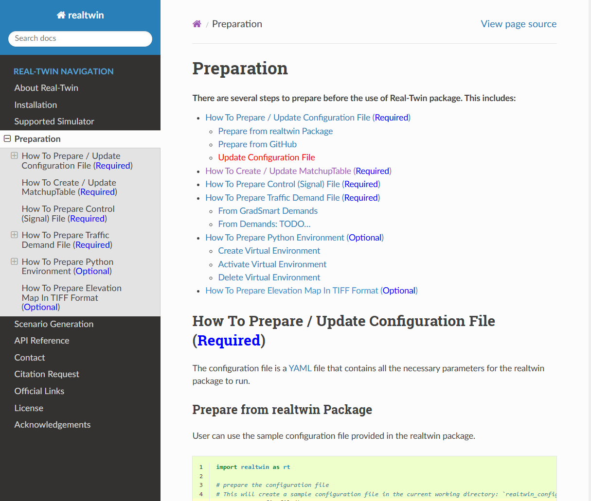

### 2025-05-22

Integration of Turn and inflow as there are errors and changes from updated code and updated processing logic.

Details:

* 1. Refactor code
* 2. Fix bugs in converting SUMO net.xml to OpenDrive .xdor (Edge ids are not consistent)
* 3. Generate executable .sunocfg before calibration (not executable in previous version)
* 4. Add logic with enable user their updated .net.xml file

TODO: continue work on Behavior calibration integration based on updated code.

### 2025-05-07

* Update readthedocs (65% Done)

  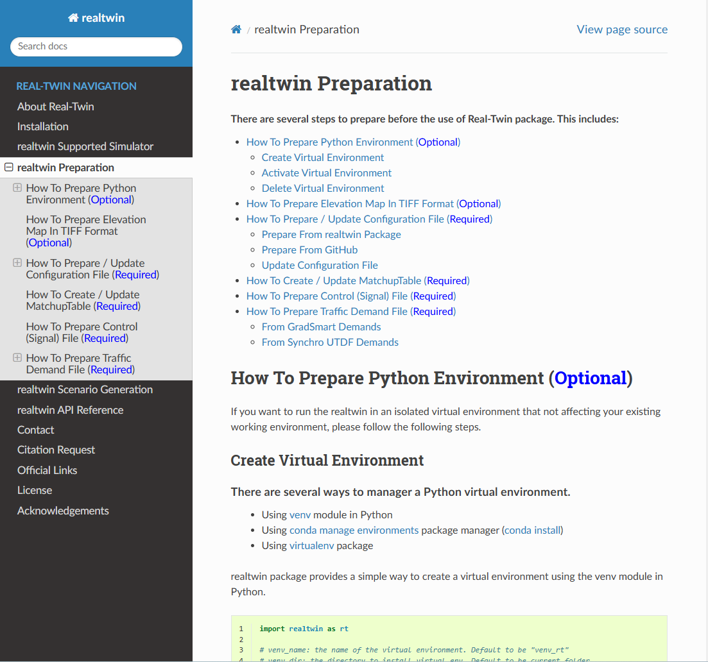
* Fix concrete generateion bugs

### 2025-05-06

* Add **demo_data: bool | string** in configuration file to enable sample data. If demo_data is true, use default data from illusstration, if the data name specified, use data from database server or data library.
* Add create_configuration_file function to generate the default configuration file to user, user can then edit the configuration as input of realtwin generation.
* Update AbstractScenario generation with including matchup table generation, folders checking (Traffic and Control)
* Update ConcreateScenario generation with updated traffic and control generation

### 2025-03-24

* update realthedocs (30%)

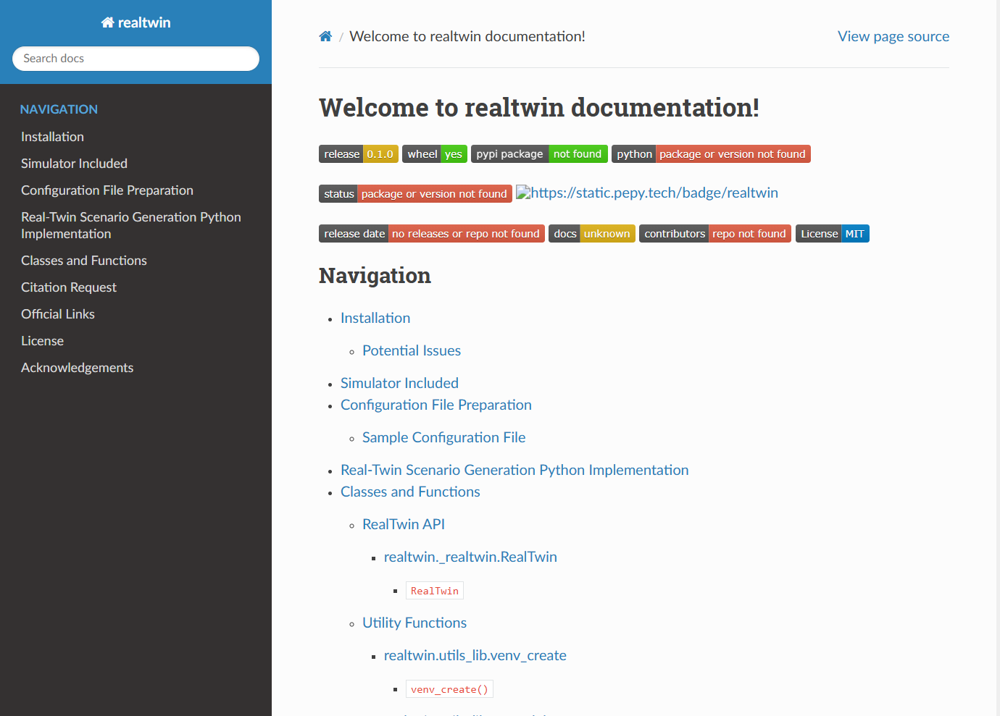

### 2025-03-19

* prepare realtwin ico for readthedocs
* prepare readthedocs (20%)

TODO: 1. continue working on readthedocs 2. format docstring for functions and classes 3. Learn documentation on real-twin project project

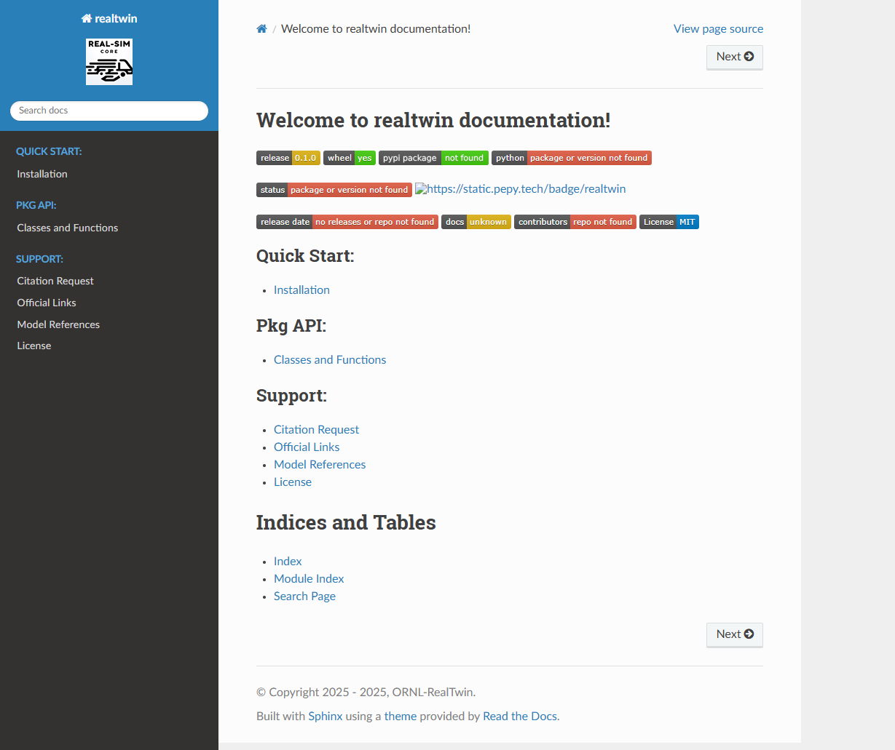

### 2025-03-18

* update code to run both original and new implementations in Calibration section
* test two sets of algorithms
* update code using universal configuration data
* TODO: 1. refactor code 2. test scenarioes (multiple combinations between turn_inflow and behavior) 3. fix potential errors from package

### 2025-03-17

* Re-design configuration file for better implementation and user-friendly midification
* Update cooresponding codes based on updates from configurations

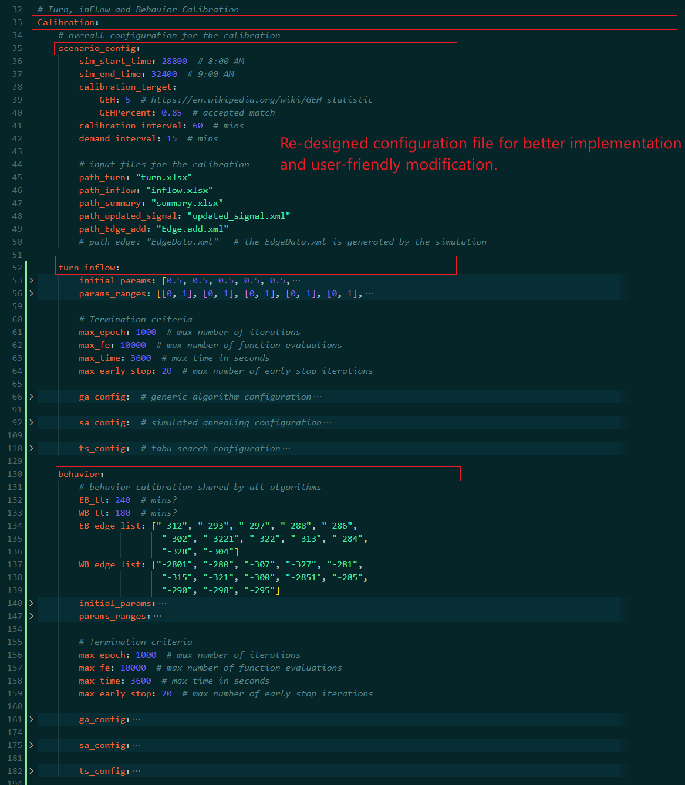

### 2025-03-12

* updated behavior optimization using mealpy

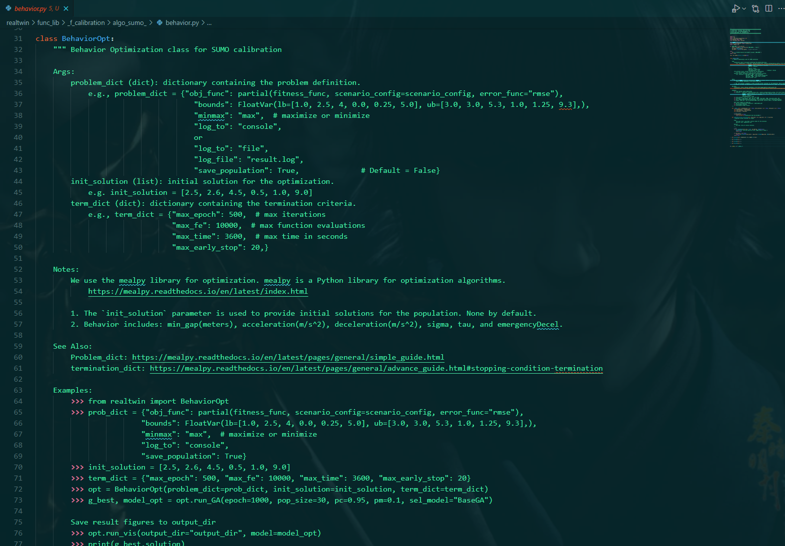

TODO: Integrate BehaviorOpt into realtwin packagte. Convert Turn and Inflow (mealpy)

### 2025-03-06

Update tuturial_dev.py and tutorial_dev.md for detailed examples

refactorred realtwin code

### 2025-03-05

1. Updated framework dragram

   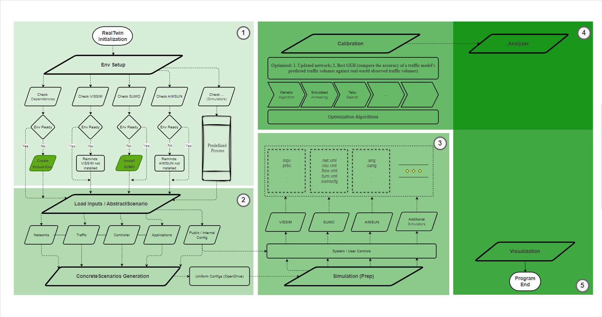
2. Explore mealpy...

### 2025-03-04

1. Create public repo: Real-Twin
2. Rename old repo to: Real-Twin-Dev

### 2025-02-28

#### Open Discussion

1. Calibration section, the current implementation is:
   Step 1: optimize Turn and Inflow, based on the optimized results(net, turn, flow, EdgeData, ect...)

   Step 2: perform Behavior optimization to generate results

   My question is: how can we make sure that we obtained the best reslution? Will step 2 change best results from step 1?

   As this is multi-objective optimization problem, if it's possible to perform turn and inflow optimization as objective 1, behavior optimization as objective 2 and optimize best results then?
2. Calibration fail on generated netwrokOne issue is that the generated network (abstract -> concreate -> simulation generation)  failed in calibration (I noticed that calibration section requires modified data and the generated network, such as chatt.net.xml, could not run in current stage). The generated network does not have additional files such as turn.xlsm, flow.xlsm, summary.csv ect...

   In this regard, we have to separate between part 1: (abstract -> concrete -> simulation preparation) and part 2: Calibration section.  Current implementation(TODO):  We can generate the network from part 2, but on part 2, we will use default data (not generated network) to calibrate results.  Any feedback?

Calibration integrated into realtwin package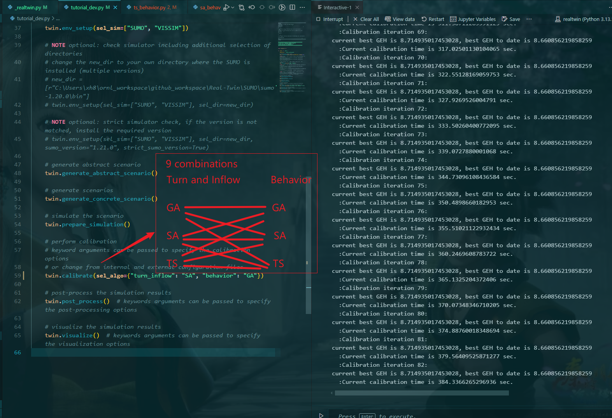

#### TODO

* refactor codes
* clean up unnecessary inputs / configs

### 2025-02-27

#### Discussion

* Input files are mixing of xlsx, csv files. We need to choose either xlsx or csv to make inputs uniform

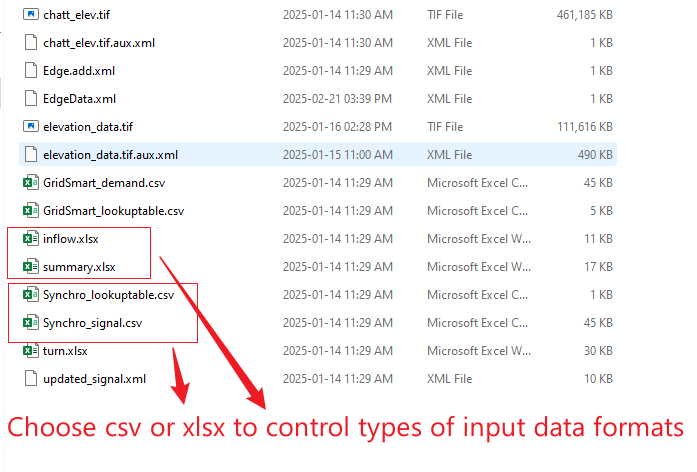

* The generated SUMO network failed during the calibration process.
* Decide whether to create public or private real-twin repositories on GitHub.
* Achieve 60% integration of the calibration section.

#### TODO

    Continueous integration contineous delivery

### 2025-01-24

* realtwin package enables Abstrace Scenario, Concrete Scenario, and Simulation generation using SUMO
* code checking and updates to score of 9.5+ / 10
* updated test functions
* update gitignore file to ignore .tif files as .tif files are too large (100MB+)
* update tutorial_dev to make clear explanation for both user and internal developers
* update requirements to enable simulation
* update configuration file to auto load  and fill missing data from loading

  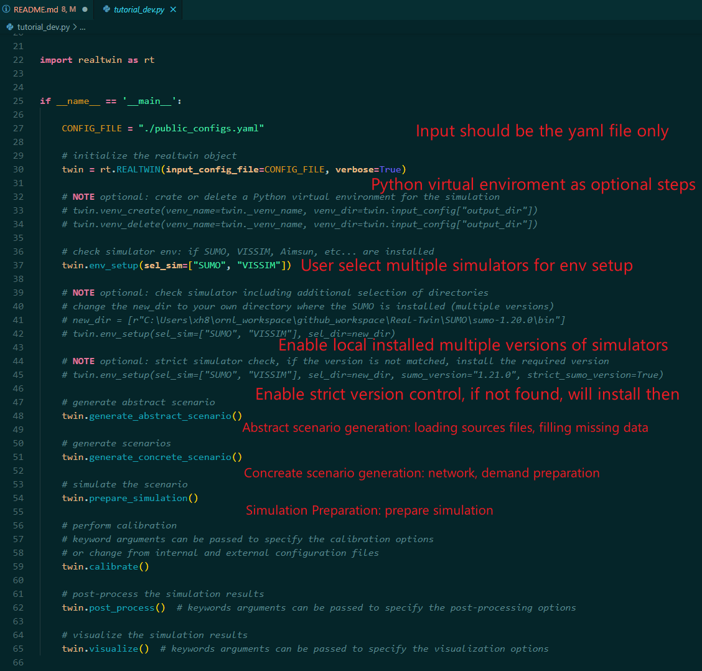

#### TODO

* Explore calibration codes for sumo

### 2025-01-03

* add several test functions: find executable, download file, simulation environment ect...
* get familiar with existing framework, eg. scenariogeneration, utdf singal conversion from Guanhao's code ect...

#### TODO

* need more time to get familar with the currently framework - current SOW, time plan, develiverables ect...

### 2024-12-31

* add func: sumo version check from all existing exectuables
* add func: enable strick sumo version check: if not installed, will install the specific version of sumo
* add func: download large single file from web with security check and process checking
* add func: find executable from system path
* add func: find executable from selected directory
* fmt: format print out message for better progress representation

  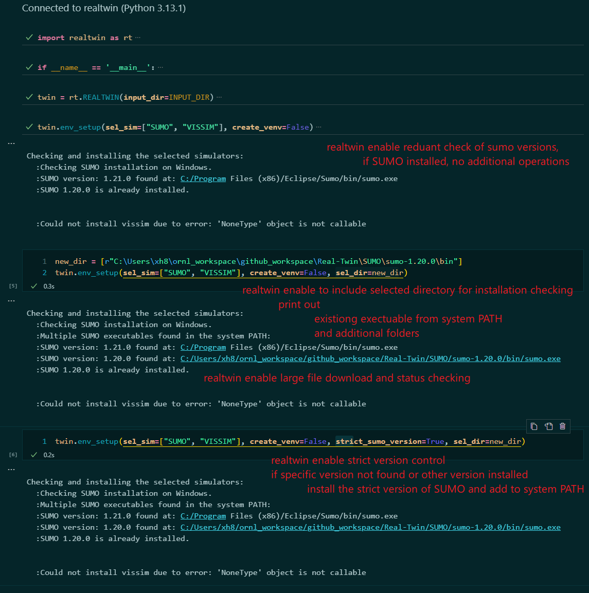

#### TODO

* get familiar with input loads (request access to shared local testing files)
* get familiar with existing visualizations (coordinate with group members and request access to their local files)

### 2024-12-30

* add tutorial_dev.md file for user & developer reference
* add test functions for the input_dir, output_dir ect...
  figure

#### TODO

* check sumo version if sumo pre-installed on user's device
* get familiar with input loads (request access to shared local testing files)
* get familiar with existing visualizations (coordinate with group members and request access to their local files)

### 2024-12-27

* add .pylintrc file for project-wide coding control
* refactored code to reach production-level
* test the current functionalities: including create venv, delete venv, check SUMO and install SUMO
* tutorial_dev.py

  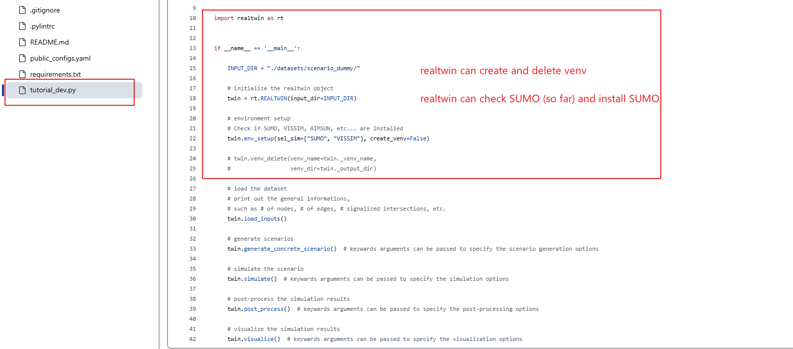

#### TODO:

* Discussion the repository license: MIT, Apache, BSD etc..., as we are writing code, we need copyright licence text as Docstring at the top of each file created.
* Add test functions perform object safety check

### 2024-12-26

* enable pylint for checking / evaluating coding for GitHub Action
* add code evaluation fuction (local checking) to perform code checking and evaluation (navigate to tests folder: pylint_proj_code_checker.py)
* update requirements.txt
* add official copyright for each document for the requirement of software development under ORNL
* add test functions

#### TODO:

* discuss the repository license: MIT, Apache, BSD etc..., as we are writing code, we need copyright licence text as Docstring at the top of each file created.
* add more test functions perform object safety check

### 2024-12-23

* re-design the realtwin development framework
* re-design the overall package framework
* add utility functions: is_sumo_installed
* add utility functions: venv_create, venv_delete
* add func_lib in install_simulator: install_sumo_windows
* add test function: test_is_sumo_installed
* 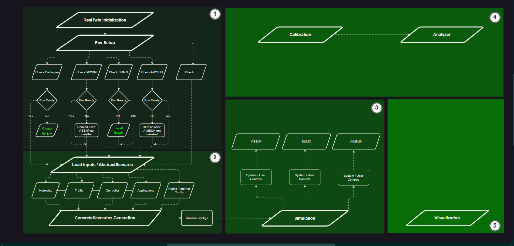

#### TODO:

* Test the overall functionalities
