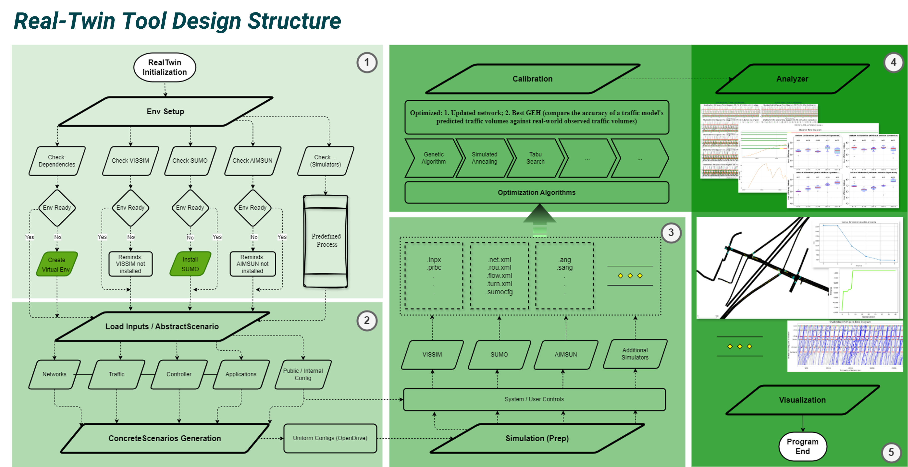
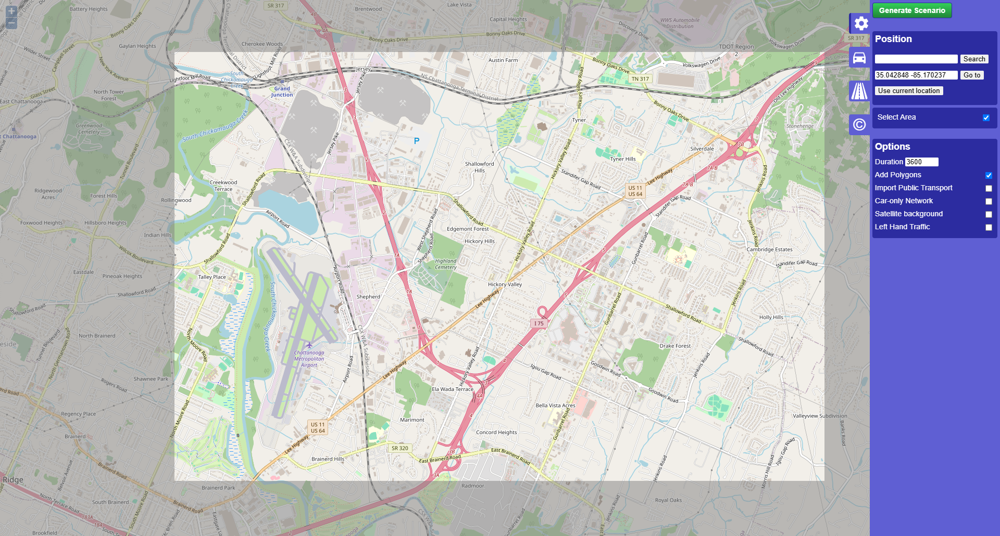
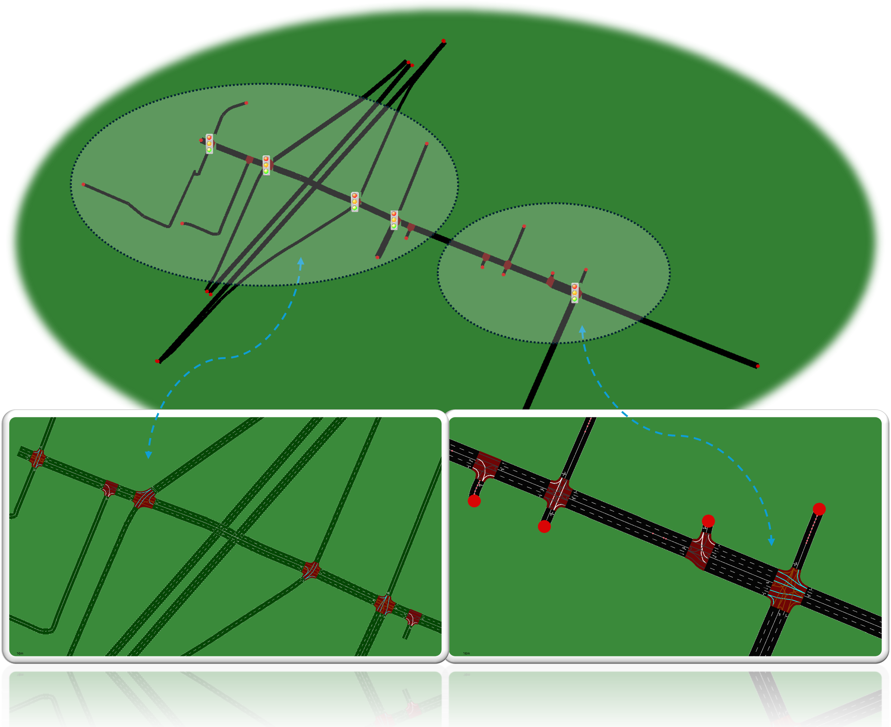

===============
About Real-Twin
===============

ORNL's Real-Twin project is a streamlined scenario generation tool that automatically integrates real-world traffic data to create high-fidelity digital twins for simulating the impacts of connected and automated vehicles in micro-simulation environments.

The current Real-Twin package supports Windows only. Prepare the Python
environment, simulator installations, and licenses on Windows before running
the scenario or autonomous-vehicle workflows.

The package exposes separate SUMO, Vissim, and Aimsun scenario classes.
Each workflow prepares a network/model, maps observed traffic to its native
movements, generates demand and optional external signals, and calibrates the
enabled stages. Existing source/model control is retained when external signal
loading is disabled. Genetic algorithm (GA), simulated annealing (SA), tabu
search (TS), and Bayesian optimization (BO) are available for calibration.

See :doc:`realtwin_simulator` for platform requirements,
:doc:`realtwin_prepare` for configuration and data preparation, and
:doc:`realtwin_generation` for the current repository examples. The Vissim
tutorial's travel-time reference is simulated; replace it with field
observations when calibrating against measured conditions.

Real-Twin Framework
===================

The framework is designed to be user-friendly, allowing users to easily generate realistic traffic scenarios by leveraging real-world data. It supports various micro-simulation platforms and is particularly useful for researchers and practitioners in the field of transportation systems, connected vehicles, and traffic management.

Here is a simple example of how to use Real-Twin to generate a traffic scenario

Sample Location Selection
=========================

Sample Scenario Generation
==========================

Sample Calibration
==================

.. image:: ../_static/chatt_net.gif
    :width: 100%
    :alt: Calibration Process
